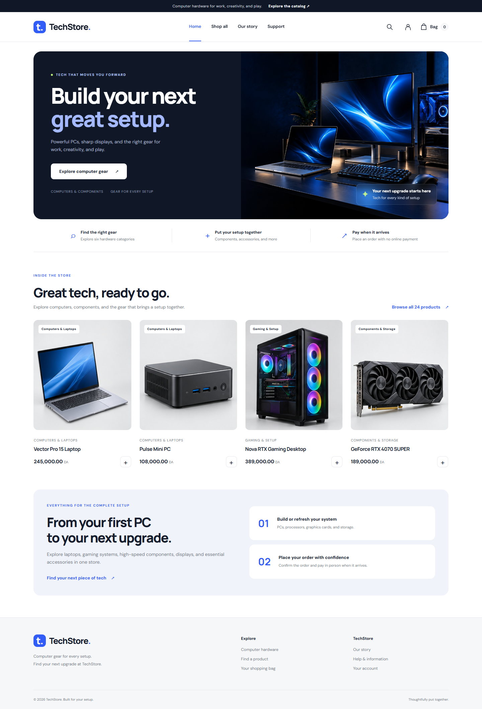

# TechStore Ecommerce

TechStore is a responsive computer-hardware storefront built with Node.js, Express, EJS, and MySQL. Customers can browse a complete starter range of computers, components, peripherals, networking equipment, and office hardware, then submit delivery orders without online payment. An administrator can review orders, confirm requests, update delivery status, and manage the product catalog.



## Features

- 24 sample computer and IT products across six hardware categories, with original photorealistic product photography hosted locally in the project.
- Search, product details, category filtering, sorting, and a quantity-editable shopping cart.
- Cash-on-delivery order requests saved to MySQL with a unique reference and status tracking.
- Password-protected administrator pages for confirming orders, updating order status, and adding, editing, or removing products.
- Responsive storefront with an original TechStore hero photograph and a full-page desktop screenshot below.

## Technology

| Area | Technology |
| --- | --- |
| Runtime and server | Node.js, Express |
| Views and interface | EJS, custom responsive CSS, vanilla JavaScript |
| Database | MySQL, mysql2 |
| Configuration | dotenv |

## Run locally

### Prerequisites

Install Node.js with npm, Git, and MySQL. Start the MySQL service before setting up the database.

### Clone and install

```bash
git clone https://github.com/touatifatima/TechStore-Ecommerce.git
cd TechStore-Ecommerce
npm install
```

If you already have this project on your computer, open a terminal in the project folder and continue below.

### Configure MySQL and the application

Copy the example environment file:

```powershell
Copy-Item .env.example .env
```

On macOS or Linux, use `cp .env.example .env`. Edit `.env` and set your local MySQL credentials and a private administrator password:

```dotenv
PORT=7000
HOST=127.0.0.1
DB_HOST=localhost
DB_PORT=3306
DB_USER=root
DB_PASSWORD=your-local-mysql-password
DB_NAME=jsp_eCommerce
SESSION_SECRET=replace-with-a-long-random-string
ADMIN_PASSWORD=choose-a-long-private-password
```

Use an empty `DB_PASSWORD` only if your MySQL account has no password. The `.env` file is ignored by Git; do not publish your credentials.

### Create the database and start TechStore

For a **new, empty database**, run:

```bash
npm run db:setup
npm run db:orders
npm run art:catalog
npm start
```

`db:setup` creates the configured database, imports the schema, and loads the TechStore hardware catalog. `db:orders` creates the tables used for cash-on-delivery order requests. `art:catalog` generates the local product illustrations. Open **http://localhost:7000** in your browser. Press `Ctrl+C` in the terminal to stop the server.

If you already set up the database, do **not** rerun `db:setup`: it intentionally refuses to overwrite a database that contains tables. To update an existing installation with the hardware catalog and illustrations, run:

```bash
npm run art:catalog
npm run db:tech-catalog
npm run db:orders
npm start
```

The catalog update preserves existing order records and their saved product and price details. Catalog images are served from `public/images/catalog/`.

### Development mode

Run `npm run dev` for automatic server restarts while editing. If you change `PORT` in `.env`, use that port in the browser instead.

## Order and product management

After setting `ADMIN_PASSWORD` in `.env` and creating the order tables, open **http://localhost:7000/dashboard**. Go to **Manage order requests** or **Manage products** and sign in with username `admin` and the private password from `.env`. The order manager displays order details and lets the administrator confirm requests or change their status. The product manager supports adding, editing, and removing catalog entries.

Customers submit their contact and delivery information at checkout. TechStore saves the request, its items, and a unique order number; payment is made in person upon delivery. The website does not process online payments.

## Main pages

| URL | Purpose |
| --- | --- |
| `/` | Store homepage |
| `/shop` | Hardware catalog |
| `/product/1` | Product details |
| `/search` | Product search |
| `/cart` | Shopping cart |
| `/checkout` | Submit a delivery order |
| `/dashboard` | Product dashboard |
| `/admin/orders` | Order management |
| `/admin/products` | Product catalog management |

## Troubleshooting

| Symptom | What to check |
| --- | --- |
| `ECONNREFUSED` | Start MySQL and verify `DB_HOST` and `DB_PORT` in `.env`. |
| `ER_ACCESS_DENIED_ERROR` | Check the MySQL username, password, and permissions. |
| Unknown database or missing tables | Run `npm run db:setup` only against a new, empty database. |
| Setup reports existing tables | The setup script protects existing data; verify `DB_NAME` or use a new, empty database. |
| `EADDRINUSE` | Stop the process using the configured port or change `PORT`. |

## Project structure

```text
controllers/       Authentication and request controllers
database/          Shared MySQL connection
public/            Styles, scripts, and product/hero images
routers/           Express routes
scripts/           Database and catalog setup utilities
sql/               Database schema and starter data
views/             EJS pages and components
.env.example       Environment configuration template
index.js           Application entry point
```

## Development note

This project is intended for local development and learning. Review authentication, authorization, database queries, and dependency audit findings before exposing a deployment to the public internet. Account registration and online payments are not part of the current order-request workflow.

## Credits

Based on [eCommerce-TOUATI-TOUAK](https://github.com/touatifatima/eCommerce-TOUATI-TOUAK). Maintained as [TechStore-Ecommerce](https://github.com/touatifatima/TechStore-Ecommerce).
